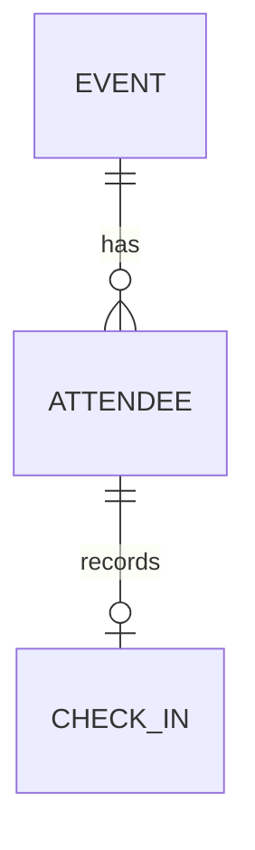

# NLW Unite DevOps

pass.in is a REST API for in-person events. It creates events, registers attendees, lists registrations, and returns badge details with a check-in URL that a client can encode as a QR code.

The project was built during Rocketseat's NLW Unite. The API uses TypeScript, Fastify, and Prisma with PostgreSQL. The DevOps track adds a Docker build, a GitHub Actions workflow that publishes the image, and a Helm chart for Kubernetes.

## Run the API locally

You need Node.js 20, pnpm 8, and Docker with the Compose plugin. Run these commands from a fresh clone.

```bash
git clone https://github.com/Erick-Alen/nlw-unite-devops.git
cd nlw-unite-devops
cp .env.example .env
pnpm install --frozen-lockfile
docker compose up -d postgres
```

Check that PostgreSQL is accepting connections before you apply the migrations.

```bash
docker compose exec -T postgres pg_isready -h 127.0.0.1 -U admin -d passin
```

Once the check reports `accepting connections`, apply the migrations and start the API.

```bash
pnpm db:migrate-deploy
pnpm dev
```

Open [Swagger UI](http://localhost:3333/docs) to explore the API. To check that the process is serving requests, run the following command in a second terminal. It returns `OK!`.

```bash
curl --fail http://localhost:3333/healthz
```

The database uses host port `5432`. If that port is in use, change the host port in [docker-compose.yaml](docker-compose.yaml) and update `DATABASE_URL` in `.env` to match. Stop the development server with Ctrl+C, then run `docker compose stop postgres` to stop PostgreSQL and keep its data.

## Try the registration and check-in flow

Open [api.http](api.http) with the VS Code REST Client extension and send the requests in order. The registration and badge requests use IDs from earlier responses. You can also use the same sequence in Swagger UI.

| Method and path | Result |
| --- | --- |
| `POST /events` | Create an event and return its `eventId`. |
| `POST /events/:eventId/attendees` | Register an attendee and return their `attendeeId`. |
| `GET /events/:eventId` | Get the event, its capacity, and its registration count. |
| `GET /attendees/:attendeeId/badge` | Get the badge details and `checkInURL`. |
| `GET /attendees/:attendeeId/check-in` | Record a check-in. Calling the returned `checkInURL` changes the attendee's check-in status. |
| `GET /events/:eventId/attendees` | List attendees and their check-in timestamps. Use `query` to filter by name and `pageIndex` to page through results, starting at zero. |

Each email can register once per event. An event can set a maximum number of registrations, and each attendee can check in once.

## Data model

An event has zero or more attendees. Each attendee belongs to one event and can have one check-in. The [Prisma schema](prisma/schema.prisma) defines these relationships and the [migrations](prisma/migrations) create the PostgreSQL tables.



## Build and deployment

- The [Dockerfile](Dockerfile) builds the TypeScript application and packages it in a Node.js 20 Alpine image. The container listens on port `3333` and applies Prisma migrations at startup.
- The [GitHub Actions workflow](.github/workflows/ci.yml) runs on pushes to `main`. It publishes the image to Docker Hub with the seven-character commit SHA and `latest` tags, then updates `image.tag` in [deploy/values.yaml](deploy/values.yaml).
- The [Helm chart](deploy/) runs the API on Kubernetes. It defines a Deployment and a ClusterIP Service, enables memory-based autoscaling by default, and sends liveness and readiness probes to `/healthz`. Before installing the chart, adapt the Deployment to read `DATABASE_URL` from a Kubernetes Secret for your PostgreSQL instance.
- The [Kubernetes examples](k8s-example/) show individual manifests for the API.
